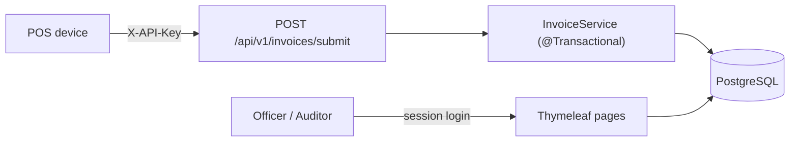

# KRA-Sim: Micro-Tax E-Invoicing and Compliance System

A portfolio simulation of an eTIMS-style e-invoicing flow and a tax compliance dashboard,
built with Java, Spring Boot and PostgreSQL.

> **Disclaimer:** KRA-Sim uses fictional demonstration data. It is **not** a live KRA system,
> is not affiliated with the Kenya Revenue Authority, and its control unit invoice numbers
> only imitate the shape of real eTIMS numbers.

## What it does

1. A compliance officer registers a taxpayer (KRA PIN, company name, email).
2. A POS device pushes a sale to `POST /api/v1/invoices/submit`, authenticated with its own API key.
3. The backend applies the 16% VAT rule, numbers the invoice per device, saves it with an audit
   trail, and increments the taxpayer's cumulative VAT liability, all in one database transaction.
4. The officer searches the PIN on the dashboard and sees the profile, invoice count,
   ledger balance and recent invoices.
5. An auditor reviews an append-only log of sign-ins, lockouts and administrative actions.

## Screenshots

### Sign in


### Compliance dashboard

Landing page, before a taxpayer is searched:


Searching a taxpayer PIN shows the profile, invoice count and VAT ledger:


An unregistered PIN gives a clear error with a link to register:


### Registering a taxpayer


### POS devices and API keys

Officers register devices. Each device gets its own key, shown once, and only a hash is stored:


### eTIMS POS simulator

Pushes a sale to the API with a device key and shows the control unit invoice number:


### Audit log (auditor role)


## Architecture



Two Spring Security filter chains keep the access models separate:
- `/api/**`: stateless, per-device API key, no cookies, no CSRF token.
- Everything else: form login, session, CSRF protection, role-based access.

## Quick start with Docker

Requires Docker with the Compose plugin.

```bash
cp .env.example .env        # then edit .env and set your own passwords
docker compose up --build
```

Open http://localhost:8080 and sign in with the officer or auditor credentials from your `.env`.

```bash
docker compose down         # stop, keep data
docker compose down -v      # stop and delete the database
```

## Run without Docker

Requires JDK 17+, Maven and a local PostgreSQL.

```bash
sudo -u postgres psql -f database/create-database.sql   # creates an empty kra_sim_db
export DB_PASSWORD=postgres
mvn spring-boot:run
```

Flyway builds the schema automatically on startup.

## Accounts

| Role | Can do | Cannot do |
|---|---|---|
| **OFFICER** | Dashboard, register taxpayers, POS simulator, manage POS devices | Read the audit log |
| **AUDITOR** | Read the audit log | Everything else |

Both accounts are created on first startup from environment variables
(`OFFICER_USERNAME` / `OFFICER_PASSWORD`, `AUDITOR_USERNAME` / `AUDITOR_PASSWORD`).
The built-in defaults are for local development only.

## Try the API

1. Sign in as the officer, open **Devices**, register a device and copy its key (shown once).
2. Register a taxpayer, then:

```bash
curl -X POST http://localhost:8080/api/v1/invoices/submit \
  -H "Content-Type: application/json" \
  -H "X-API-Key: PASTE_THE_DEVICE_KEY" \
  -d '{"taxpayerPin": "A112233445Z", "amountBeforeTax": 10000}'
```

A KSh 10,000 sale returns `201 Created` with `vatAmount: 1600.00` and a
`controlUnitInvoiceNo` such as `SCU000001/000001`. Without a valid key the API returns `401`.

## Tests

```bash
mvn test
```

- **Unit tests** (Mockito): VAT maths, rounding, ledger accumulation, key hashing, throttle logic.
- **Web security tests** (MockMvc): 401 without a key, 201 with one, redirect to login, role access, CSRF, lockout.
- **Integration tests** (Testcontainers + real PostgreSQL): Flyway migrations, database constraints,
  append-only audit triggers, and 20 concurrent invoices receiving unique, gapless control numbers
  and a correct ledger total. These need Docker and are skipped automatically if it is not running.

## Security design

- Officer passwords are stored as BCrypt hashes.
- POS API keys are random 256-bit secrets. Only a SHA-256 hash is stored, the key is shown once,
  and it can be rotated or revoked.
- Sign-in is throttled per username and per IP, and the check runs before the password is verified.
- The audit table is append-only, enforced by database triggers.
- Device-management audit rows are written in the same transaction as the action.
- Audit values are stripped of control characters (log forging) and HTML-escaped on display.
- Money uses `BigDecimal` with `HALF_UP` rounding. A row lock on the device and ledger prevents
  duplicate numbers and lost updates.

## Project structure

```
src/main/java/com/krasim/compliance/
├── controller/   web pages and the REST API
├── dto/          request, response and view records
├── entity/       JPA entities
├── exception/    domain exceptions
├── repository/   Spring Data repositories
├── security/     filter chains, API-key filter, login throttling
└── service/      tax logic, devices, audit
src/main/resources/db/migration/   Flyway migrations (V1 to V5)
src/main/resources/docs/screenshots/   README images
Dockerfile, docker-compose.yml
```

## Known limitations

- Login throttle counters live in memory (reset on restart, not shared across servers).
- Behind a reverse proxy the client IP would need to come from a trusted `X-Forwarded-For` header.
- The application connects as a database owner. Production should use a least-privilege role.
- Accounts are seeded at startup. There is no user-management screen.
- No HTTPS in the bundled setup. Terminate TLS in front of the app for any real deployment.

## Credits

- Font: Inter (SIL Open Font License). Icons: Bootstrap Icons (MIT).
# KRA-Sim: Micro-Tax E-Invoicing and Compliance System

A portfolio simulation of an eTIMS-style e-invoicing flow and a tax compliance dashboard,
built with Java, Spring Boot and PostgreSQL.

> **Disclaimer:** KRA-Sim uses fictional demonstration data. It is **not** a live KRA system,
> is not affiliated with the Kenya Revenue Authority, and its control unit invoice numbers
> only imitate the shape of real eTIMS numbers.

## What it does

1. A compliance officer registers a taxpayer (KRA PIN, company name, email).
2. A POS device pushes a sale to `POST /api/v1/invoices/submit`, authenticated with its own API key.
3. The backend applies the 16% VAT rule, numbers the invoice per device, saves it with an audit
   trail, and increments the taxpayer's cumulative VAT liability, all in one database transaction.
4. The officer searches the PIN on the dashboard and sees the profile, invoice count,
   ledger balance and recent invoices.
5. An auditor reviews an append-only log of sign-ins, lockouts and administrative actions.

## Screenshots

### Sign in


### Compliance dashboard

Landing page, before a taxpayer is searched:


Searching a taxpayer PIN shows the profile, invoice count and VAT ledger:


An unregistered PIN gives a clear error with a link to register:


### Registering a taxpayer


### POS devices and API keys

Officers register devices. Each device gets its own key, shown once, and only a hash is stored:


### eTIMS POS simulator

Pushes a sale to the API with a device key and shows the control unit invoice number:


### Audit log (auditor role)


## Architecture


Two Spring Security filter chains keep the access models separate:
- `/api/**`: stateless, per-device API key, no cookies, no CSRF token.
- Everything else: form login, session, CSRF protection, role-based access.

## Quick start with Docker

Requires Docker with the Compose plugin.

```bash
cp .env.example .env        # then edit .env and set your own passwords
docker compose up --build
```

Open http://localhost:8080 and sign in with the officer or auditor credentials from your `.env`.

```bash
docker compose down         # stop, keep data
docker compose down -v      # stop and delete the database
```

## Run without Docker

Requires JDK 17+, Maven and a local PostgreSQL.

```bash
sudo -u postgres psql -f database/create-database.sql   # creates an empty kra_sim_db
export DB_PASSWORD=postgres
mvn spring-boot:run
```

Flyway builds the schema automatically on startup.

## Accounts

| Role | Can do | Cannot do |
|---|---|---|
| **OFFICER** | Dashboard, register taxpayers, POS simulator, manage POS devices | Read the audit log |
| **AUDITOR** | Read the audit log | Everything else |

Both accounts are created on first startup from environment variables
(`OFFICER_USERNAME` / `OFFICER_PASSWORD`, `AUDITOR_USERNAME` / `AUDITOR_PASSWORD`).
The built-in defaults are for local development only.

## Try the API

1. Sign in as the officer, open **Devices**, register a device and copy its key (shown once).
2. Register a taxpayer, then:

```bash
curl -X POST http://localhost:8080/api/v1/invoices/submit \
  -H "Content-Type: application/json" \
  -H "X-API-Key: PASTE_THE_DEVICE_KEY" \
  -d '{"taxpayerPin": "A112233445Z", "amountBeforeTax": 10000}'
```

A KSh 10,000 sale returns `201 Created` with `vatAmount: 1600.00` and a
`controlUnitInvoiceNo` such as `SCU000001/000001`. Without a valid key the API returns `401`.

## Tests

```bash
mvn test
```

- **Unit tests** (Mockito): VAT maths, rounding, ledger accumulation, key hashing, throttle logic.
- **Web security tests** (MockMvc): 401 without a key, 201 with one, redirect to login, role access, CSRF, lockout.
- **Integration tests** (Testcontainers + real PostgreSQL): Flyway migrations, database constraints,
  append-only audit triggers, and 20 concurrent invoices receiving unique, gapless control numbers
  and a correct ledger total. These need Docker and are skipped automatically if it is not running.

## Security design

- Officer passwords are stored as BCrypt hashes.
- POS API keys are random 256-bit secrets. Only a SHA-256 hash is stored, the key is shown once,
  and it can be rotated or revoked.
- Sign-in is throttled per username and per IP, and the check runs before the password is verified.
- The audit table is append-only, enforced by database triggers.
- Device-management audit rows are written in the same transaction as the action.
- Audit values are stripped of control characters (log forging) and HTML-escaped on display.
- Money uses `BigDecimal` with `HALF_UP` rounding. A row lock on the device and ledger prevents
  duplicate numbers and lost updates.

## Project structure

```
src/main/java/com/krasim/compliance/
├── controller/   web pages and the REST API
├── dto/          request, response and view records
├── entity/       JPA entities
├── exception/    domain exceptions
├── repository/   Spring Data repositories
├── security/     filter chains, API-key filter, login throttling
└── service/      tax logic, devices, audit
src/main/resources/db/migration/   Flyway migrations (V1 to V5)
src/main/resources/docs/screenshots/   README images
Dockerfile, docker-compose.yml
```

## Known limitations

- Login throttle counters live in memory (reset on restart, not shared across servers).
- Behind a reverse proxy the client IP would need to come from a trusted `X-Forwarded-For` header.
- The application connects as a database owner. Production should use a least-privilege role.
- Accounts are seeded at startup. There is no user-management screen.
- No HTTPS in the bundled setup. Terminate TLS in front of the app for any real deployment.

## Credits

- Font: Inter (SIL Open Font License). Icons: Bootstrap Icons (MIT).
